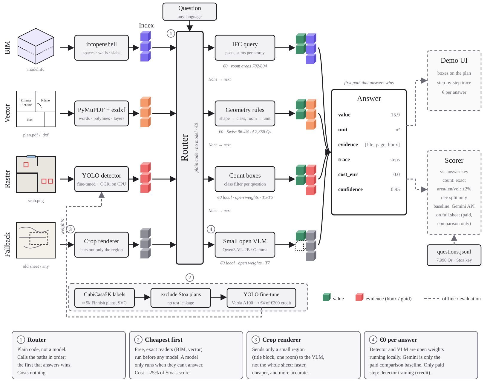

# Junction-2K26

Our entry for Junction 2026 (Espoo, 13–15 Nov). Agents do the building; humans steer.

## Setup (once, 5 min)
1. Clone, then run: `bash scripts/setup.sh`. Fix anything marked `FIX`.
   - Turns on the git hook that guards `main`. Checks `node`, `gh auth`, git name, `claude`/`codex`.
2. Codex users: allow network in `~/.codex/config.toml` (see `AGENTS.md` → Codex setup).
3. Open your agent in the repo and ask: "What's the workflow here?" It should describe `AGENTS.md`.

## How it works
- **The repo is the team's shared memory.** Agents read and write a few files; nobody re-explains anything.
- **Code → PR → a human merges.** Agents can't push code to `main` (git hook + Claude deny rules).
- **Status → straight to `main`.** Tickets, log, ideas and context go through `node scripts/status.mjs`, so everyone sees changes within a minute.
- **Agents review each other.** Claude PRs are reviewed by Codex and vice versa; the verdict lands as a PR comment.

| File | What it is |
|---|---|
| `AGENTS.md` | The agents' rulebook. Read it once. |
| `DECISION.md` | The chosen idea and scope. |
| `CONTRACT.md` | How the parts connect (APIs, protocols, pins). |
| `TASKS.md` + `tickets/` | Ticket queue and details. |
| `LOG.md` | Decisions and dead ends, newest first. |
| `context/` | Challenge briefs and partner docs. Paste them here. |
| `ideas/` | Each person's ideas, for picking one. |

## Your job as a human
- **Watch the board:** `node board/serve.mjs` → http://localhost:8787. Tickets, deadlines, open PRs, review verdicts, questions.
- **Answer questions:** blocked tickets show a question on the board. Tell your agent the answer.
- **Merge PRs:** check the cross-review comment and the verify steps, then merge on GitHub or `gh pr merge <n> --squash --delete-branch`.
- **Hardware:** do the human steps written in the PR and confirm.
- **Steer:** tell your agent what area to work on, e.g. "take the next fw ticket".

## The weekend
1. **Opening (Fri 18:00):** paste every challenge brief into `context/challenges/`. Ask your agent: "Publish to context."
2. **Ideas:** each agent writes 3–5 ideas to `ideas/<name>.md` from the template, then critiques a teammate's file and scores them.
3. **Fri 21:00:** humans vote. An agent writes `DECISION.md` (PR, merge it).
4. **Planning:** one agent fills `CONTRACT.md` (PR), then splits the work into tickets.
5. **Fri 23:55:** preliminary submission.
6. **Build:** each person's agents claim tickets in their area and open PRs. Humans merge.
7. **Sat 22:00:** feature freeze. **Sun 10:00:** final submission.

## Rules that matter
- Never commit secrets. Share `.env` values directly with teammates.
- Commits: `type: summary`, author only, no AI co-author lines.
- Repo setup pushes by a human only: `ALLOW_MAIN_PUSH=1 git push`.
